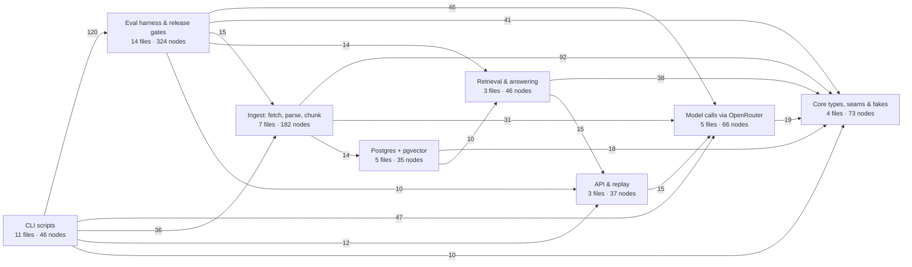

# 01 · Multimodal Document Q&A (RAG)

> Part of my AI projects portfolio → **https://tcbryan17.github.io** · See the other projects there.

Ask plain-English questions over long documents, including ones where the answer is in a chart or diagram rather than the text. Every answer cites the exact source page.

## Scope
- **Corpora:** two public collections, chosen because they're shaped differently:
  - **SEC 10-K filings** from EDGAR: dense text and financial tables, published as HTML. Apple, Microsoft and Johnson & Johnson, with Costco held out to test generalisation.
  - **FAA *Pilot's Handbook of Aeronautical Knowledge*** (FAA-H-8083-25C): a public-domain PDF of about 500 pages, with hundreds of figures (instrument diagrams, labelled drawings, performance charts that must be read to answer a question) mixed with decorative photos.
- **Question types:** fact lookup, reading a figure, and explaining a concept. When an answer comes from a figure, the figure is shown.
- **Public documents only.** Never personal data.
- **Disclaimer (shown in the UI):** "Not financial, legal, or flight-training advice."

## Stack
Python · FastAPI · Postgres + pgvector (Docker Compose) · psycopg 3 with raw SQL · embedding, reranking and generation models through OpenRouter, zero-data-retention endpoints only · own retrieval code, no LangChain or LlamaIndex

Each architectural choice has a decision record in [`docs/decisions/`](docs/decisions/README.md).

## Pipeline
1. **Ingest:** parse HTML and PDF while keeping printed page labels and section headers. Route each element by type: text, tables, informational figures, and decorative images. A vision model describes each informational figure.
2. **Chunk and index:** structure-aware chunks, each with a short context header, embedded into pgvector alongside a keyword full-text index.
3. **Retrieve:** hybrid search (vector + keyword, fused with Reciprocal Rank Fusion), then rerank to the top 3–5 passages.
4. **Answer:** the LLM answers only from the retrieved passages (and the figure images among them) and returns citations `[doc, page]`, or says "I don't know".
5. **Evaluate:** reviewed Q&A sets for each corpus, with a held-out split (the dev split was reviewed by Claude for this demo, not a human: ADR 0020). It tracks recall@5, correctness, faithfulness, citation accuracy, abstention, and prompt-injection resistance, and compares cost against quality across models.

## Code map

A knowledge graph of the code, built with [graphify](https://github.com/Graphify-Labs/graphify) from a local tree-sitter parse. No model was involved and no code left the machine. It covers `src/`, `scripts/` and the SQL migrations: 53 files, 964 nodes and 2,619 edges. 88% of the edges were read directly from the code and 12% were inferred by graphify's name resolution.

The diagram below collapses that graph into subsystems. An arrow means "uses", and its number counts the calls, imports and type references that cross between the two subsystems. Links with fewer than 10 are hidden.



How to read it:
- **Core types, seams & fakes** is what everything else depends on. Each model and parser sits behind a `Protocol`, with a fake beside it for tests (ADR 0012).
- **The eval harness** is the largest single subsystem, with 324 of the 964 nodes.
- **The `db → answer` arrow is a type, not a call.** The repository functions annotate their connections with the `Conn` alias defined in `search.py`.

**Explore it in full:**
- [Interactive graph](https://tcbryan17.github.io/assets/code-graph/multimodal-doc-rag.html) (also linked from the portfolio site's project card): click nodes, filter by community, search. The source is [`docs/code-graph/graph.html`](docs/code-graph/graph.html).
- [`GRAPH_REPORT.md`](docs/code-graph/GRAPH_REPORT.md): the most-connected abstractions, the 60 detected communities, and surprising links.
- [`graph.json`](docs/code-graph/graph.json): the full graph, queryable with `graphify query "..."`, `graphify path A B` or `graphify explain X`.

To rebuild after code changes, see [`docs/code-graph/README.md`](docs/code-graph/README.md).

## API contract (used by the site)
```
POST /ask   { "question": str, "corpus"?: str, "doc"?: str }
→ { "answer": str,
    "citations": [{ "doc": str, "page": str, "page_end"?: str,
                    "snippet": str, "image_url"?: str }],
    "trace": [{ "step": str, "detail": str, "ms": int }] }
```
Citation markers in `answer` point into `citations`: `[k]` is `citations[k-1]`. `page` is the printed page label (e.g. `"4-12"` in the handbook). `page_end` appears when a passage spans a page break. `image_url` appears when the cited passage is a figure; in the replay file it's an inline `data:` URI. See [ADR 0005](docs/decisions/0005-ux-and-ask-contract.md).

```
GET /figures/{chunk_id}.png   → image/png (cached for a year; 404 if that chunk has no figure)
```
`image_url` in a live response is this path, relative to the API's base URL. A figure's image never changes after ingestion, and chunk ids are never reused, so the response is safe to cache indefinitely.
`scripts/save_replay.py` saves one real response to `replay/sample-run.json`, and `scripts/export_site_replay.py` turns it into the portfolio site's replay events. The site plays it as this project's demo. **There is no public live endpoint yet**, so visitors can't type their own questions. The API runs locally (see Development). A rate-limited public endpoint comes at deployment, and the release check (ADR 0016) must pass before it ships.

## Development
Needs [uv](https://docs.astral.sh/uv/) and a Docker runtime (I use [OrbStack](https://orbstack.dev)).
```bash
cp .env.example .env
docker compose up -d --wait   # Postgres + pgvector on localhost:5433
uv sync
uv run pytest
uv run uvicorn multimodal_doc_rag.api:app --reload
```

Building the index (needs `OPENROUTER_API_KEY` in `.env`; every run has a spending cap):
```bash
uv run python scripts/fetch_corpus.py                      # public 10-Ks + FAA handbook into data/
uv run python scripts/ingest_corpus.py --dry-run           # parse + cost estimate, no model calls
uv run python scripts/ingest_corpus.py --preflight-only    # ~1 cent check of the live model APIs
uv run python scripts/ingest_corpus.py                     # ingest; report in reports/ingest/
```
Evals (gold set, metrics, LLM judge, injection tests) are described in [`evals/README.md`](evals/README.md).

## Governance
The system is mapped to the NIST AI RMF (with its Generative AI Profile) and the OWASP Top 10 for LLM Applications (2026). Release gates were pre-registered before any eval ran. A release check fails unless every gate passes on held-out evidence, and deployment will be required to pass it. See [`docs/governance/`](docs/governance/README.md) and [ADR 0016](docs/decisions/0016-governance-and-release-gates.md).

## Status
In progress. Build-plan steps 0–14 and 16 are done; [`docs/build-plan.md`](docs/build-plan.md) has the detail.

**Done:**
- The whole pipeline is built and tested: parsers, chunking, hybrid search, reranking, grounded answers with figure images, and the `/ask` API.
- Both corpora are ingested: 25 documents, with 493 of 496 figures described.
- A recorded run plays on the portfolio site.

**Eval:**
- The harness, the LLM judge and the pre-registered release gates are built.
- The dev gold set is reviewed: 105 questions, reviewed by Claude for this demo ([ADR 0020](docs/decisions/0020-dev-gold-set-reviewed-by-claude.md)).

**Next:**
1. The owner writes the FAA figure questions.
2. Smoke runs, then the dev baseline.
3. Judge calibration against the owner's hand grades.
4. The held-out run and the release check.
5. Deployment of a public, rate-limited `/ask` endpoint, so visitors can ask their own questions.
