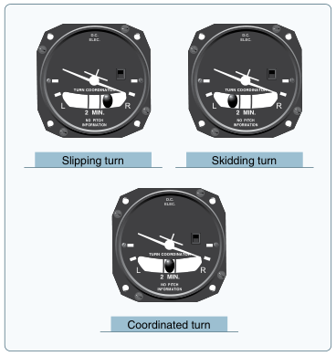
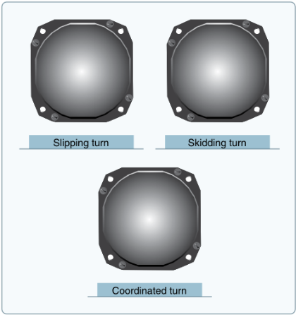

# 0006. Parsing: hand-rolled HTML for EDGAR; the PDF parser is chosen by a spike

- **Status:** Accepted (PDF parser: PyMuPDF, chosen after the spike below)
- **Date:** 2026-11-07

## Context
Citations depend on parsing. Every element we extract must keep its page (index and printed label), its section path and its kind (text, table or figure). The two corpora arrive in different formats:
- **EDGAR 10-Ks** are HTML, so the structure already exists. Pages come from CSS `page-break-before/after` markers and footer page numbers. Sections are "Item 1A", "Item 7" and so on. Tables are real `<table>` elements.
- **The FAA handbook** is a PDF, which stores positioned text and drawings, not paragraphs and headings. Figures may be **raster** (embedded images, easy to extract) or **vector** (drawn from lines and text, so there is no image object and the region has to be inferred). We don't yet know the mix.

## Options considered
**EDGAR HTML**
- **Hand-rolled BeautifulSoup + lxml.** A few hundred lines covering page breaks, Item detection and table-to-Markdown. Fully visible.
- **`edgartools`.** Splits filings into Items and handles EDGAR quirks. Faster to start, but page-number handling may still need our own code, and the logic is hidden.

**FAA PDF**
- **PyMuPDF.** Fast. It exposes text blocks, fonts and images with coordinates, and can render any region to PNG. It's explicit and explainable, but vector figures need our own region detection. AGPL licence (fine for a public repo).
- **Docling (IBM, MIT licence).** A layout model detects headings, tables and figures (raster or vector) with captions. Better structure without extra work, but it's a heavy dependency (PyTorch), slower, and more of a black box. It would run only at ingestion time.
- **Decide on paper.** Quicker, but we'd be guessing about the raster/vector mix.

## Decision
- **EDGAR:** hand-rolled BeautifulSoup + lxml.
- **FAA:** run a 1–2 hour **spike** before the parsing and chunking types are designed. Run PyMuPDF and Docling on two figure-heavy chapters and measure:
  - raster vs vector figure count
  - heading accuracy
  - figure–caption pairing
  - speed

  Choose from the evidence, and record the results below.

Both parsers implement one `Parser` protocol, so the chunker and the contract tests don't care which format a document came from.

## Why
The 10-K structure is already in the HTML, so a library adds little we can't explain. For the PDF, the right answer depends on a fact we can measure cheaply, so we measure it rather than guess.

## Spike results (2026-11-07)
We ran both parsers on two figure-heavy chapters: Ch. 8 (Flight Instruments, 39 figures) and Ch. 11 (Aircraft Performance, 34 figures). PyMuPDF ran through a ~190-line prototype. Docling ran with its default pipeline.

| | PyMuPDF (prototype) | Docling (default) |
|---|---|---|
| Figures found | 73/73 | 71, including 3 false positives (chapter-opener thumbnails); 8 Ch. 11 charts classified as tables |
| Figure numbers linked | 73/73 (read from the text layer) | 2 wrong numbers (8-27 and 8-28 read as "3-23" and "3-24"), 1 unlinked, 1 fragmented |
| Crops | ~3 of 73 visibly wrong (e.g. 8-38 merged with 8-37) | **Instrument dial faces render blank** (Figs. 8-22, 8-24, 8-32) |
| Printed page labels | 56/56 (footer pattern) | 55/56 (in the "furniture" layer) |
| Headings | Correct hierarchy, but ~21 missed (no rule yet for "Sample Problem" headings) | Nearly all found, but every heading flattened to level 1 |
| Reading order | Correct | Correct |
| Speed per chapter | 2–6 s, including crops | 14 s (OCR off) to 75 s (OCR on); 109 packages including PyTorch |

**Most figures are vector drawings:** 57 of the 73 (Ch. 8: 28 of 39; Ch. 11: 29 of 34). Extracting only the embedded images would miss them, so figure regions must be found (from caption positions and drawing clusters) and rendered.

The key evidence is Fig. 8-22 (turn coordinator in a slipping, skidding and coordinated turn). PyMuPDF's render keeps the aircraft symbol and ball. Docling's crop shows empty bezels, so the information needed to answer the question is gone:

| PyMuPDF | Docling |
|---|---|
|  |  |

**Not measured:** only 2 of 17 chapters were tested; headings were judged by eye; the timings come from single runs; no vision model was run on the crops.

## PDF parser decision
**PyMuPDF.** It renders vector figures faithfully, and it reads figure numbers and page labels reliably. It's about 10x faster, needs no PyTorch, and every rule is code we can explain. The cost: we write and test the layout rules ourselves (figure regions, splitting adjacent figures, heading levels for fonts such as Times-Bold 10, and excluding the chapter-opener image). The estimate is ~150–250 lines. A hybrid (Docling headings with PyMuPDF crops) was rejected: it needs both dependencies and two structures to reconcile. Revisit if other chapters make the layout rules unmanageable.

## Consequences
- Figure elements carry a bounding box, a rendered PNG crop, the figure number and caption, and whether the figure is raster or vector.
- PyMuPDF is AGPL. That's fine for this public, open-source repo, but a closed-source deployment would need a commercial licence or a different parser.
- The PDF parser needs fixture tests for the known edge cases: adjacent figures, captions on the next line, chapter openers.
